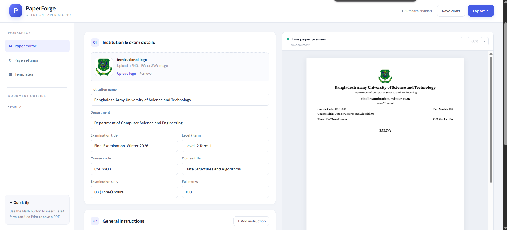
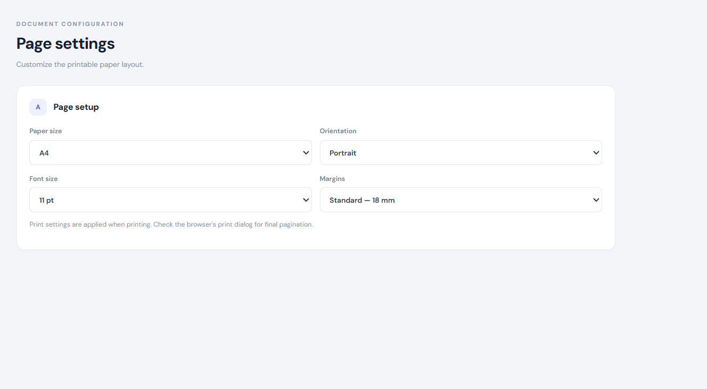
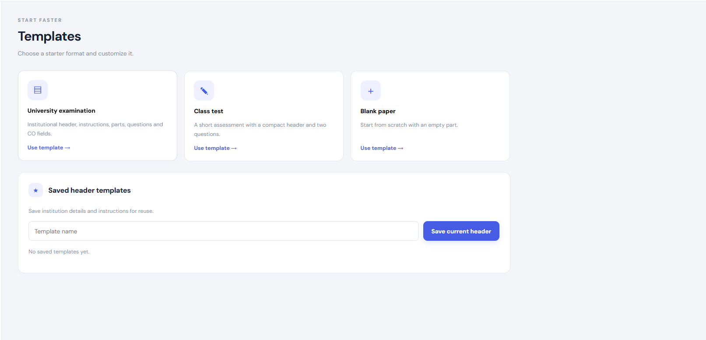
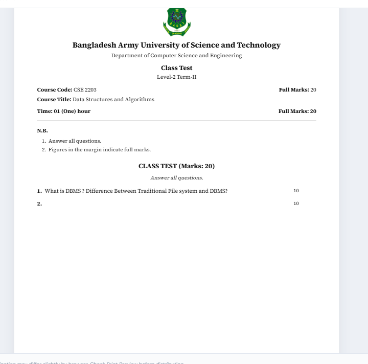

# PaperForge — Question Paper Builder

**A modern, browser-based examination paper editor for creating, formatting, previewing, and exporting professional question papers.**

PaperForge is a lightweight web application designed to simplify the process of preparing academic examination papers. It provides an intuitive editing workspace, a live A4 document preview, customizable page settings, reusable templates, and multiple export options.

Built with HTML, CSS, and vanilla JavaScript, PaperForge runs directly in the browser without requiring a backend server or a complex development environment.

---

## Table of Contents

- Overview
- Features
- Technology Stack
- Project Structure
- Getting Started
- How to Use
- Export Options
- Question Paper Customization
- Data Storage
- Browser Compatibility
- Limitations
- Future Enhancements
- Contributing
- License
- Author

---
# Screen Shot





## Overview

Preparing a well-structured examination paper involves more than writing questions. Academic documents often require institutional branding, examination metadata, general instructions, organized question parts, mark allocation, course outcome mapping, mathematical expressions, and consistent page formatting.

PaperForge brings these tasks together in a single workspace.

The application enables educators, university faculty members, and academic institutions to build examination papers, monitor their layout through a live preview, and export the final document for printing or further editing.

### Key Highlights

- Real-time question paper preview.
- Structured parts, questions, and sub-questions.
- Support for marks allocation and Course Outcome (CO) mapping.
- LaTeX mathematical formula rendering.
- Institutional logo upload.
- Printable A4 and US Letter document layouts.
- Editable Microsoft Word document export.
- JSON project backup and restoration.
- Local draft autosaving.
- Reusable header templates.

---
# ScreenShots


## Features

### 1\. Institution and Examination Details

Configure the document header with essential academic information, including:

- Institution name.
- Department name.
- Examination title.
- Academic level and term.
- Course code and course title.
- Examination duration.
- Full marks.
- Institutional logo.

Uploaded logos appear in the document preview and can also be included in Word exports when supported.

### 2\. General Instructions

Create and manage examination instructions using a dedicated editor.

- Add new instructions.
- Edit existing instructions.
- Remove individual instructions.
- Preview instructions in the examination document.

### 3\. Questions and Parts Management

Organize examination content into multiple parts, such as Part A, Part B, and additional sections.

Each part supports:

- Custom part titles.
- Part-wise marks.
- Part-specific instructions.
- Multiple main questions.
- Question numbering.
- Question marks.
- Course Outcome (CO) fields.
- Nested sub-questions.
- Sub-question marks and CO mapping.
- Reordering of parts and questions.
- Removal of questions, sub-questions, and parts.

The editor automatically updates the question count and document outline as content changes.

### 4\. Rich Text Formatting

Format question content with basic text styling tools.

- **Bold**
- _Italic_
- \<u\>Underline\</u\>

These tools help emphasize important terms, instructions, and mathematical notation.

### 5\. Mathematical Formula Support

PaperForge integrates [MathJax](<https://www.mathjax.org/>) to render mathematical expressions written in LaTeX.

Example:

latex

```
T(n) = 2T(n/2) + n
```

Integral example:

latex

```
\int_0^\infty e^{-x}\,dx = 1
```

Enter a formula using the Math button in the question editor. The expression is inserted using dollar-sign delimiters and rendered in the live preview when MathJax is available.

### 6\. Image Insertion

Insert diagrams, illustrations, and other supporting images directly into question content.

Supported image formats include PNG, JPEG, WebP, and GIF.

- Maximum question image size: 3 MB per image.
- Maximum institutional logo size: 2 MB.

Images are embedded in the saved project as data URLs, allowing them to remain available when the project is exported and imported.

### 7\. Live A4 Document Preview

Preview the examination paper while editing.

The preview reflects changes to:

- Examination metadata.
- Instructions.
- Parts and questions.
- Marks and CO fields.
- Mathematical expressions.
- Embedded images.
- Page settings.

Adjust the preview zoom level to inspect the document at different scales.

### 8\. Page Settings

Customize the printable document layout with the following options:

| Setting | Available options |
| --- | --- |
| Paper size | A4, US Letter |
| Orientation | Portrait, Landscape |
| Font size | 10 pt, 11 pt, 12 pt |
| Margins | Narrow (12 mm), Standard (18 mm), Wide (25 mm) |

These settings control the print layout and the corresponding preview configuration.

### 9\. Built-in Templates

Start with a predefined document structure instead of creating a paper from scratch.

| Template | Description |
| --- | --- |
| University Examination | A complete academic examination paper structure |
| Class Test | A compact assessment with two initial questions |
| Blank Paper | An empty part ready for custom content |

You can also save reusable header templates containing institution details, examination metadata, instructions, and the institutional logo.

### 10\. Automatic Draft Saving

PaperForge uses browser `localStorage` to save the current document locally.

- Automatically saves changes after a short delay.
- Provides a manual **Save draft** option.
- Restores a valid saved draft when the application is reopened in the same browser.
- Preserves examination metadata, instructions, questions, settings, and uploaded logo data.

No account is required for local draft storage.

---

## Technology Stack

PaperForge is built with lightweight frontend technologies.

| Technology | Purpose |
| --- | --- |
| HTML5 | Application structure and semantic content |
| CSS3 | Layout, styling, responsiveness, and print formatting |
| Vanilla JavaScript | Application logic, editing, storage, and exports |
| MathJax 3 | LaTeX mathematical expression rendering |
| docx.js 8.5.0 | Microsoft Word document generation |
| Google Fonts | DM Sans and Source Serif 4 typography |
| Browser APIs | Local storage, file handling, and document printing |

The application does not require a JavaScript framework, backend API, or database server.

---

## Project Structure

Organize the project files as follows:

text

```
PaperForge/
├── index.html       # Main application interface
├── styles.css       # Application styling and print layout
├── script.js        # Editor logic and export functionality
└── README.md        # Project documentation
```

The application loads MathJax and the Word export library from external CDNs.

---

## Getting Started

### Prerequisites

You will need:

- A modern web browser.
- A local copy of the project files.
- An internet connection for loading the externally hosted fonts and JavaScript libraries.

### Installation

**1\. Clone the repository**

Replace `YOUR_USERNAME` with your GitHub username and `YOUR_REPOSITORY` with the actual repository name.

bash

```
git clone https://github.com/YOUR_USERNAME/YOUR_REPOSITORY.git
```

**2\. Navigate to the project directory**

bash

```
cd YOUR_REPOSITORY
```

**3\. Launch the application**

The simplest option is to open `index.html` in your browser.

For a more reliable local development setup, use a local HTTP server.

With Python:

bash

```
python -m http.server 8000
```

Then open:

text

```
http://localhost:8000
```

Alternatively, use the Live Server extension in Visual Studio Code.

### Deployment

PaperForge is a static frontend application and can be deployed to services that host static websites, including:

- GitHub Pages
- Netlify
- Vercel

Upload or deploy the project files while keeping the HTML, CSS, and JavaScript files in the expected locations.

---

## How to Use

### Step 1: Enter Examination Details

Open the PaperForge application and update the institution name, department, examination title, course information, examination duration, and full marks.

Upload an institutional logo if needed.

### Step 2: Configure General Instructions

Add the instructions that should appear before the questions. Remove any instructions that are not relevant to the examination.

### Step 3: Build the Question Paper

Use the question editor to:

1. Create or rename examination parts.
2. Set marks for each part.
3. Add main questions.
4. Write question statements.
5. Add sub-questions where necessary.
6. Specify marks and Course Outcomes.
7. Reorder questions or parts as required.

### Step 4: Format Questions

Use the formatting toolbar to apply bold, italic, and underline styles.

Use the **Math** button to insert LaTeX formulas and the **Image** button to add diagrams.

### Step 5: Review the Preview

Inspect the live document preview to check the header, question structure, marks allocation, instructions, and overall layout.

Use the zoom controls and page settings to improve readability and print formatting.

### Step 6: Save and Export

Draft changes are saved locally in the browser. You can also save manually or export a project backup.

Choose the appropriate export option depending on whether you need a printable document, an editable Word file, or a complete project backup.

---

## Export Options

PaperForge provides four document and project management options.

| Option | Output | Purpose |
| --- | --- | --- |
| Print / Save as PDF | PDF through the browser print dialog | Printing or sharing the final examination paper |
| Download Word (.docx) | Microsoft Word document | Editing and further document formatting |
| Download project (.json) | JSON file | Backing up the complete project data |
| Import project (.json) | Restored project | Continuing work from a previously exported backup |

### PDF Export

Select **Export → Print / Save as PDF**.

The browser's print dialog allows you to print the paper or save it as a PDF file.

Review the print preview before distribution because pagination can differ from the editor preview.

### Word Export

Select **Export → Download Word (.docx)** to generate an editable Word document.

The export includes the examination header, instructions, parts, questions, sub-questions, marks, and CO fields. Supported institutional logo data is also included.

**Note:** The Word export is a generated document rather than a pixel-perfect copy of the browser preview. Some rich-text formatting, mathematical rendering, image placement, or page settings may require additional adjustment in Microsoft Word or a compatible editor.

### JSON Project Backup

Select **Export → Download project (.json)** to save the complete project data, including document content, settings, and logo data.

To continue working later, choose **Export → Import project (.json)** and select the previously downloaded project file.

Keep backup files in a safe location, particularly before resetting the current document or switching devices.

---

## Question Paper Customization

PaperForge is designed to accommodate different examination formats.

Examples include:

- University semester examinations.
- Midterm and final examinations.
- Class tests and quizzes.
- Computer science and engineering assessments.
- Mathematics and science examinations.
- Course Outcome (CO)-mapped assessments.
- Examinations containing diagrams and formulas.

The default sample paper demonstrates a university examination format with multiple parts, instructions, marks allocation, and nested questions.

The sample institution and examination details are demonstration content and can be replaced with your own information.

---

## Data Storage

PaperForge currently uses browser-local storage instead of a remote database.

| Data | Storage method |
| --- | --- |
| Current draft | Browser `localStorage` |
| Saved header templates | Browser `localStorage` |
| Uploaded logo | Embedded data URL |
| Inserted question images | Embedded data URLs |
| Downloaded project backup | Local JSON file |
| Exported examination paper | PDF or DOCX file |

### Important Considerations

- Drafts are stored in the current browser and are not automatically synchronized across devices.
- Clearing browser data may remove locally stored drafts and templates.
- Large embedded images can increase storage usage.
- JSON backups should be used to transfer projects between browsers or devices.
- PaperForge does not currently provide user accounts, cloud synchronization, or collaborative editing.

---

## Browser Compatibility

PaperForge is intended for modern desktop and mobile browsers that support standard HTML, CSS, and JavaScript features.

Recommended browsers include:

- Google Chrome
- Microsoft Edge
- Mozilla Firefox
- Apple Safari

For the best experience with document editing, mathematical rendering, and Word/PDF exports, use an up-to-date desktop browser.

An internet connection is required to load the externally hosted fonts and libraries in the current implementation. Some features may be limited when these external resources are unavailable.

---

## Limitations

The current version has several practical limitations:

- Draft storage is local to the browser.
- There is no cloud backup or multi-user collaboration.
- Print pagination may differ from the live preview.
- Word exports may not preserve every aspect of rich-text formatting or mathematical rendering.
- Mathematical formulas depend on MathJax loading successfully.
- Word export depends on the external `docx` library being available.
- The current implementation does not automatically validate whether question marks, part marks, and full marks add up correctly.
- Custom header templates primarily store metadata, instructions, and logo data rather than complete question structures.

These limitations can be addressed in future releases as the project evolves.

---

## Future Enhancements

Potential improvements for future versions include:

- [ ]Drag-and-drop question and part reordering.
- [ ]Automatic marks calculation and validation.
- [ ]More advanced rich-text editing.
- [ ]Improved mathematical formula support in Word exports.
- [ ]Page numbering and customizable headers and footers.
- [ ]Additional examination templates.
- [ ]Cloud storage and cross-device synchronization.
- [ ]User authentication and role-based access.
- [ ]Collaborative examination paper editing.
- [ ]Import and export support for additional document formats.
- [ ]Enhanced accessibility and keyboard navigation.
- [ ]Offline support and progressive web app functionality.

---

## Contributing

Contributions, bug reports, feature suggestions, and documentation improvements are welcome.

To contribute:

1. Fork the repository.
2. Create a feature branch.bash
   ```
   git checkout -b feature/your-feature-name
   ```
3. Make your changes and test the application in a browser.
4. Commit your changes.bash
   ```
   git add .
   git commit -m "Add: describe your changes"
   ```
5. Push your branch.bash
   ```
   git push origin feature/your-feature-name
   ```
6. Open a pull request describing your changes.

Please keep contributions focused, maintain the existing coding style, and verify that editing, saving, importing, and exporting continue to work as expected.

---

## License

No license has been specified for this project yet.

Before publishing the repository for reuse or accepting external contributions, add a `LICENSE` file with the license you intend to use.

For example, the MIT License is a common option for open-source projects, provided its terms meet your requirements.

---

## Author

**PaperForge — Question Paper Builder**

Developed to make academic examination paper preparation more structured, efficient, and accessible.

- **GitHub:** 0xCYB3RW0LFF6T9
- **Repository:** `https://github.com/0xCYB3RW0LFF6T9/Paper_Forge`

